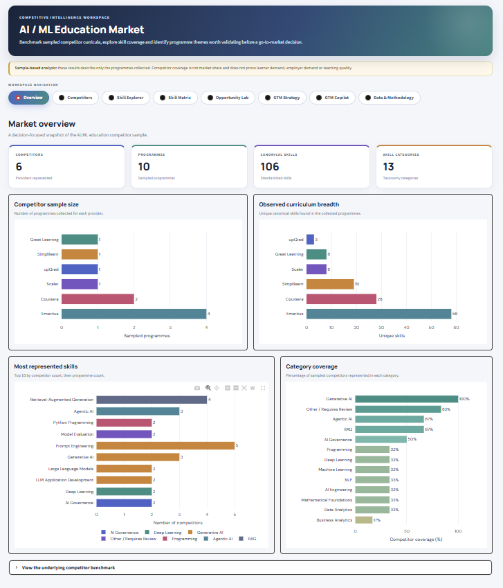
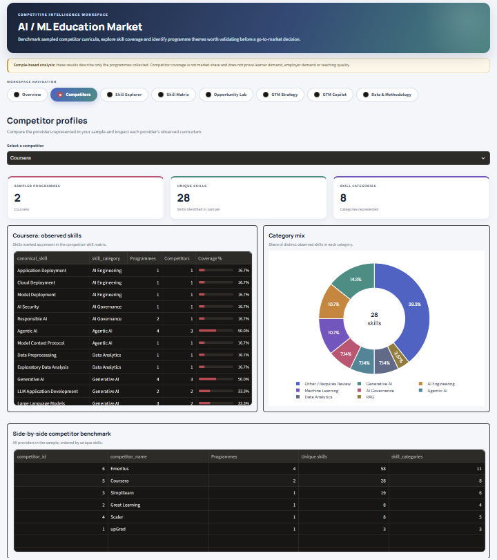
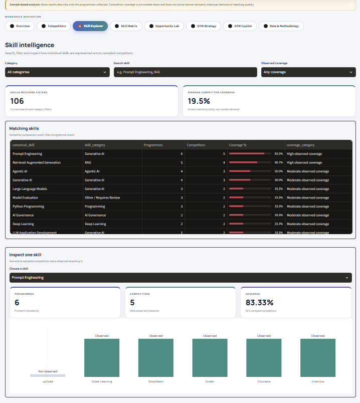
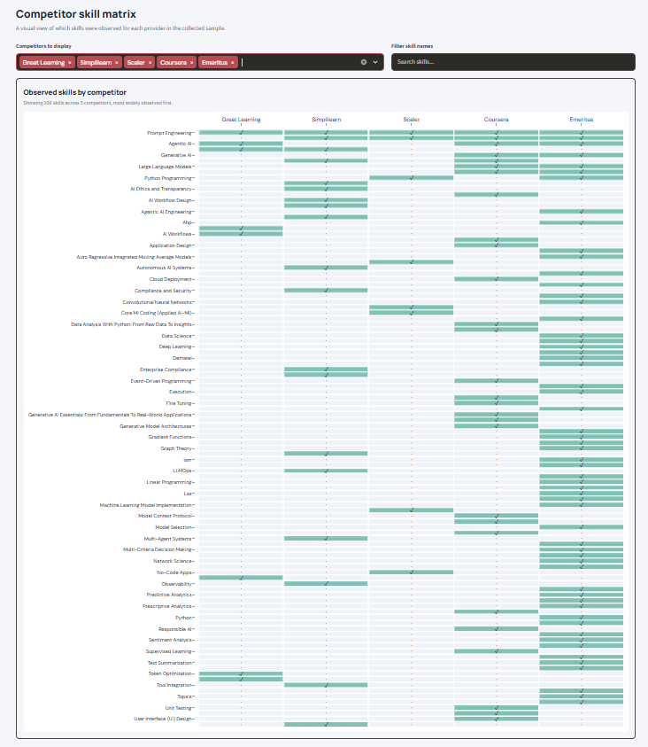
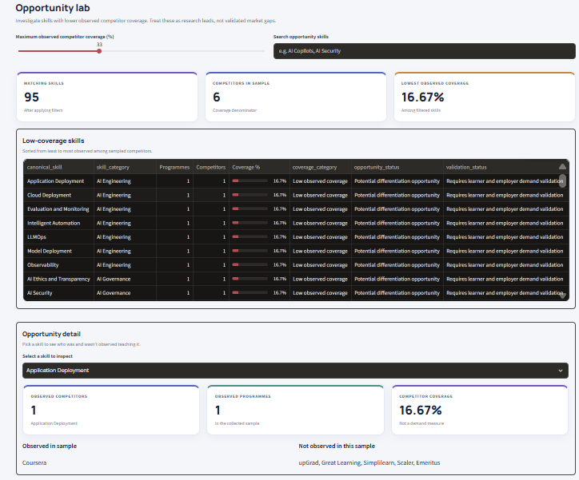
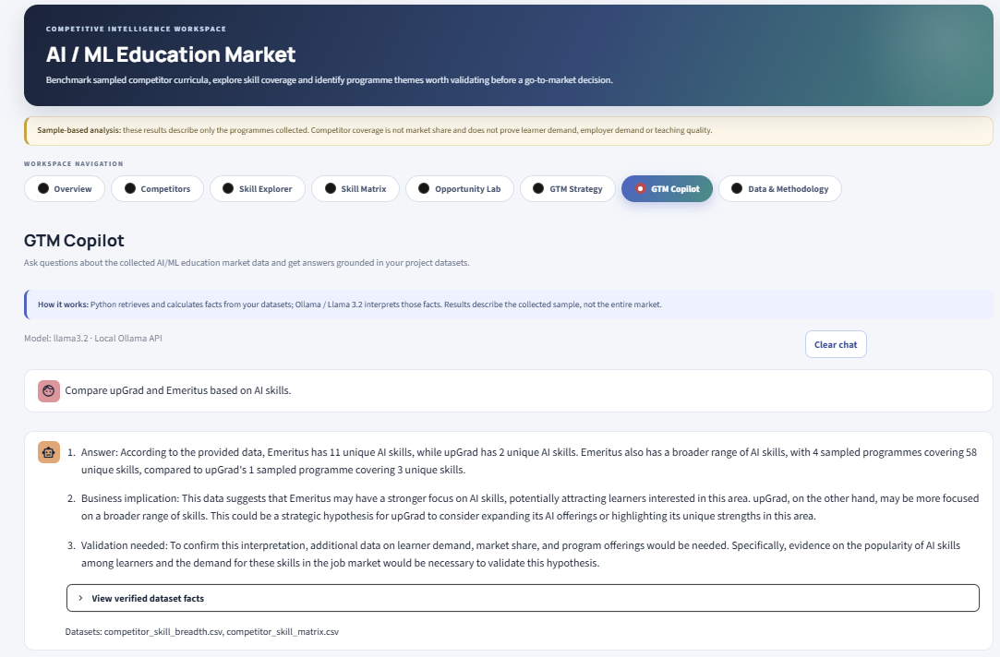
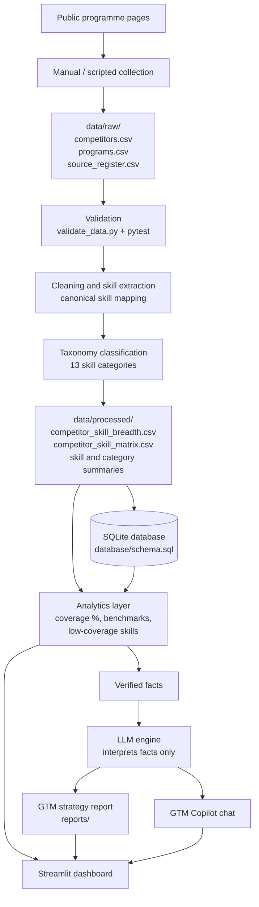

# AI-Powered Competitive Intelligence & GTM Copilot

A research-backed prototype that benchmarks AI/ML education programmes from public programme-page information and turns the structured data into competitor intelligence, skill-gap leads and go-to-market (GTM) recommendations.

> **Important:** All results describe the *collected sample only*. Competitor coverage is not market share and does not prove learner demand, employer demand or teaching quality. Low-coverage skills are research leads, not validated market gaps.

---

## Table of contents

1. [What this project does](#what-this-project-does)
2. [Dashboard preview](#dashboard-preview)
3. [Data flow](#data-flow)
4. [Dataset](#dataset)
5. [Key findings](#key-findings)
6. [Setup](#setup)
7. [How to run](#how-to-run)
8. [Project structure](#project-structure)
9. [Methodology and limitations](#methodology-and-limitations)
10. [Roadmap](#roadmap)

---

## What this project does

- Collects AI/ML programme data from six EdTech providers (Emeritus, Coursera, Simplilearn, Great Learning, Scaler, upGrad).
- Extracts and standardizes skills into a canonical skill list and a 13-category taxonomy.
- Calculates all factual metrics (counts, coverage %) in Python from the CSV data.
- Uses an LLM only to *interpret* those verified facts and propose hypotheses (programme ideas, learner segments, pricing research, pilot design, KPIs).
- Presents everything in an interactive Streamlit workspace with eight tabs.

**Design principle:** Python calculates facts, the LLM interprets them. Every AI-generated recommendation is labelled as a hypothesis that needs validation.

---

## Dashboard preview

Save your screenshots in `docs/images/` using the names below.

### Overview

Market snapshot: 6 competitors, 10 programmes, 106 canonical skills, 13 categories, plus charts for sample size, curriculum breadth, most represented skills and category coverage.

### Competitors

Per-provider profile with observed skills, category mix and a side-by-side benchmark.

### Skill Explorer

Search and filter skills by category and coverage, and inspect which competitors teach a given skill.

### Skill Matrix

Skill-by-competitor heatmap showing who teaches what.

### Opportunity Lab

Low-coverage skills filtered by a maximum coverage threshold, with a validation status for each lead.

### GTM Strategy

Generated strategy: executive interpretation, programme opportunities, programme design, learner segments, pricing framework, pilot, KPIs and risks.

### GTM Copilot

Chat interface that answers questions grounded in the project datasets, with a "View verified dataset facts" expander.

---

## Data flow



### Stage by stage

| Stage | Input | Output | Where |
|---|---|---|---|
| 1. Collect | Public programme pages | Raw CSVs with source URL, review date, caveats | `data/raw/` |
| 2. Validate | Raw CSVs | Pass/fail data-quality checks | `src/data_processing/validate_data.py`, `tests/` |
| 3. Clean and standardize | Raw skills text | Canonical skills, one row per competitor-skill | `src/data_processing/` |
| 4. Classify | Canonical skills | Skill category (13 categories) | `src/data_processing/` |
| 5. Store | Processed data | SQLite tables | `database/`, `src/database/` |
| 6. Analyze | Processed data | Coverage %, benchmarks, opportunity candidates | `src/analytics/` |
| 7. Interpret | Verified facts | Hypotheses, programme design, GTM plan | `src/ai_engine/` |
| 8. Present | All of the above | Interactive dashboard and reports | `dashboard/`, `reports/` |

**Guardrail:** the LLM only receives numbers that Python has already computed. It never invents counts.

---

## Dataset

Raw files in `data/raw/`:

- `competitors.csv`: six initial EdTech/platform targets.
- `programs.csv`: 13 programme records collected from public programme pages.
- `source_register.csv`: one source record per programme (URL, review date, verification status, caveats).

The current analysed sample (after processing) is:

| Metric | Value |
|---|---|
| Competitors | 6 |
| Programmes | 10 |
| Unique canonical skills | 106 |
| Skill categories | 13 |

**Data quality rule:** numeric fees are populated only where a source disclosed a numeric amount. A blank fee means no fixed INR price was captured. Fee/tax treatment is kept separate. Programme pages and prices change; re-check before making business decisions.

---

## Key findings

All figures are calculated from the collected sample.

### Competitor benchmark

| Competitor | Sampled programmes | Unique skills | Skill categories |
|---|---|---|---|
| Emeritus | 4 | 58 | 11 |
| Coursera | 2 | 28 | 8 |
| Simplilearn | 1 | 19 | 6 |
| Great Learning | 1 | 8 | 4 |
| Scaler | 1 | 8 | 5 |
| upGrad | 1 | 3 | 3 |

### Most represented skills

| Skill | Programmes | Competitors | Coverage |
|---|---|---|---|
| Prompt Engineering | 6 | 5 | 83.33% |
| Retrieval-Augmented Generation | 5 | 4 | 66.67% |
| Agentic AI | 4 | 3 | 50.00% |
| Generative AI | 4 | 3 | 50.00% |
| Large Language Models | 3 | 2 | 33.33% |
| Model Evaluation | 3 | 2 | 33.33% |
| Python Programming | 3 | 2 | 33.33% |

### Category coverage (top)

| Category | Competitor coverage |
|---|---|
| Generative AI | 100.00% |
| Other / Requires Review | 83.33% |
| Agentic AI | 66.67% |
| RAG | 66.67% |
| AI Governance | 50.00% |

### Takeaways

1. **Generative AI is table stakes.** Every sampled competitor covers it, and Prompt Engineering appears at 5 of 6 providers.
2. **RAG and Agentic AI are the next tier,** covered by roughly half to two thirds of providers.
3. **Governance, evaluation and deployment skills are thinly covered.** Examples: AI Copilots, AI Ethics and Transparency, AI Security, Agentic AI Frameworks, Cloud Deployment, Observability. Each is seen at only one provider (16.67%).
4. **Emeritus has by far the broadest curriculum** (58 skills across 4 programmes), partly because more of its programmes were sampled.
5. **Many skills sit in "Other / Requires Review"** (47 of 106), so the taxonomy needs refinement.

### AI-generated hypotheses (to be validated)

The strategy tab proposes three programme themes: AI Copilots, AI Ethics and Transparency, and Agentic AI Frameworks. Each lists the hypothesis, the research needed (learner and employer demand validation), a pricing research framework, a 6-week pilot, and GTM KPIs (qualified leads, lead-to-enrolment conversion, cost per lead, completion, satisfaction, project completion).

These are leads, not conclusions. A low-coverage skill may be low-coverage because there is no demand for it.

---

## Setup

Windows PowerShell:

```powershell
python -m venv .venv
.\.venv\Scripts\Activate.ps1
python -m pip install -r requirements.txt
copy .env.example .env
```

If PowerShell blocks activation:

```powershell
Set-ExecutionPolicy -Scope Process -ExecutionPolicy Bypass
.\.venv\Scripts\Activate.ps1
```

macOS / Linux:

```bash
python -m venv .venv
source .venv/bin/activate
pip install -r requirements.txt
cp .env.example .env
```

### LLM configuration

Edit `.env` for the LLM you use.

- **Local (Ollama + Llama 3.2),** used by the GTM Copilot in the current dashboard:
  ```bash
  ollama pull llama3.2
  ollama serve
  ```
- **OpenAI (optional):** set `OPENAI_API_KEY` in `.env`.

The dashboard's analytics tabs work without any LLM. Only GTM Strategy generation and GTM Copilot need one.

---

## How to run

Run these in order from the project root.

```powershell
# 1. Validate raw data and run tests
python src/data_processing/validate_data.py
pytest

# 2. (Re)build processed data / database  -- adjust to your script names
python src/data_processing/clean_data.py
python src/database/load_data.py

# 3. Launch the dashboard
streamlit run dashboard/app.py
```

Then open http://localhost:8501.

> Replace the step 2 script names with the actual files in your repo if they differ.

### Using the dashboard

1. **Overview:** read the market snapshot.
2. **Competitors:** pick a provider to see its skills and category mix.
3. **Skill Explorer / Skill Matrix:** find which providers teach a skill.
4. **Opportunity Lab:** lower the coverage slider to list low-coverage skills.
5. **GTM Strategy:** read the generated plan.
6. **GTM Copilot:** ask questions such as "Compare upGrad and Emeritus based on AI skills."
7. **Data & Methodology:** review sources and limitations.

---

## Project structure

```text
data/raw/              competitors.csv, programs.csv, source_register.csv
data/processed/        cleaned data and skill matrices
database/              schema.sql
src/data_collection/   web/API collection modules
src/data_processing/   validation and cleaning
src/database/          database loading
src/ai_engine/         LLM analysis and prompts
src/analytics/         competitor and market analytics
dashboard/             Streamlit interface
reports/               generated research reports
notebooks/             exploratory analysis
tests/                 automated tests
docs/images/           screenshots and diagrams used in this README
```

---

## Methodology and limitations

- The sample covers only collected programmes, not every programme a provider offers. Providers with more sampled programmes (for example Emeritus) naturally show more skills.
- Skill extraction and taxonomy classification may contain errors.
- Coverage does not establish learner demand, employer demand, market share or teaching quality.
- Pricing and placement claims are not validated by these reports.
- LLM output is interpretation, not evidence. Small local models can produce vague or repetitive text, so review before use.
- Programme pages change; re-check sources before business decisions.

---

## Roadmap

1. Expand the sample (more programmes per provider, more providers) to reduce sampling bias.
2. Build a repeatable collection pipeline.
3. Improve taxonomy to shrink "Other / Requires Review".
4. Add demand signals (job postings, search trends) to validate opportunities.
5. Add GTM report export (PDF/DOCX).
6. Improve strategy prompts so learner segments and programme designs differ meaningfully.
